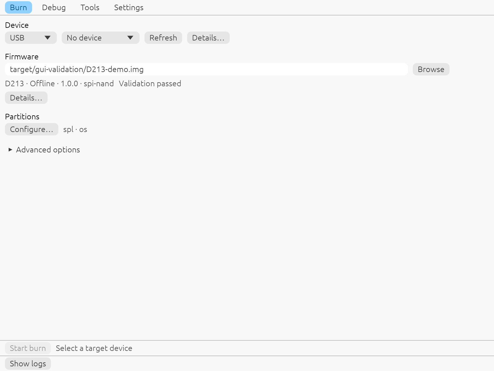

# artinchip-flash

[English documentation](docs/en/README.md) · [简体中文文档](docs/zh-CN/README.md)

Cross-platform CLI and egui GUI for flashing ArtInChip SoCs over USB or UART, with a Rust SDK for firmware inspection, upgrade plans and device operations.

## Quick start

Download a package from [GitHub Releases](https://github.com/boa-z/artinchip-flash/releases), or build the CLI and GUI with the repository's pinned Rust toolchain. See the [build prerequisites](docs/en/development.md#build).

```sh
cargo build --locked --release --bins
```

Put the board in upgrade mode, check the image and preview the plan before selecting the target. See the [user guide](docs/en/usage.md) for installation, UART and GUI instructions.

```sh
artinchip-flash scan
artinchip-flash info firmware.img
artinchip-flash burn firmware.img --plan --json
```



## Rust SDK

Use the `artinchip-flash` package in `crates/artinchip-flash`. Enable USB or UART as needed, or disable default features for offline use. See the [SDK guide](docs/en/sdk.md).

## License

Project code and assets use the [Apache License 2.0](LICENSE). See [licensing and provenance](docs/en/development.md#licensing-and-provenance) for upstream sources and third-party terms.
