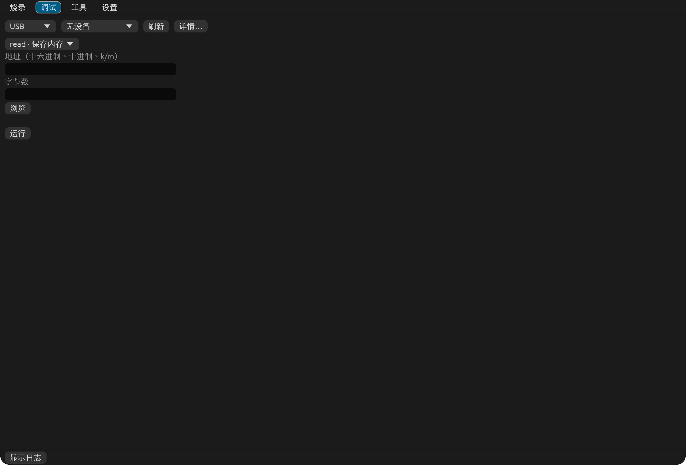

# Command and compatibility reference

[Documentation](README.md) · [简体中文](../zh-CN/reference.md)

## CLI and GUI entry points

Use `artinchip-flash <command> --help` for arguments and options. The GUI calls the same Rust services as the CLI. Diagnostic results can be copied or exported as JSON. To export burn events, enable JSON capture in **Advanced options** before burning, then open **Latest structured result** in Tools or Settings.

| CLI | GUI entry |
| --- | --- |
| `scan` | Burn/Debug → USB picker, or Tools → Scan ArtInChip USB |
| `usb-list` | Tools → List all USB devices |
| `serial-list` | Burn/Debug → UART picker, or Tools → List serial ports |
| `burn` | Burn → Start burn, or Tools → Offline burn plan |
| `info` | Burn → Firmware details, or Device details → Device info |
| `uart-monitor` | Burn → UART → UART monitor |
| `env-check` | Tools → Environment check |
| `install-usb-access` | Tools → Driver |
| `write` | Debug → Write memory file |
| `read` | Debug → Save memory |
| `writel` | Debug → Write word |
| `readl` | Debug → Read word |
| `exec` | Debug → Execute address |
| `hexdump` | Debug → View memory |
| `fill` | Debug → Fill bytes |
| `clear` | Debug → Zero memory |
| `memtest` | Debug → Test and restore RAM |
| `shcmd` | Debug → Bootloader shell |
| `log` | Debug → Read device log |
| `stats` | Settings → Statistics |
| `sd-list` | Tools → List physical disks (read-only) |
| `update` | Settings → Check for updates |

## Storage inspection and erase previews

Tools queries media and partition table text through native UPG. Geometry probing is experimental, requires U-Boot stage 1 and depends on bootloader support. The erase calculator is offline. Enter Flash geometry in bytes or MMC geometry in logical sectors with a confirmed sector size. Offsets and lengths are always in bytes. Partition calculations require physical boundaries. A UBI volume such as `ubiroot:rootfs` identifies an upgrade target and cannot supply raw NAND erase bounds.

## AiBurn compatibility and limits

- Standard USB/UART flashing, image inspection, and memory and bootloader diagnostics run natively. Optional vendor operations, including eFuse and JTAG commands, require a separately installed `upgcmd` configured in Settings. ADB upgrade entry uses the configured executable or the Android Platform Tools on `PATH`.
- Full-chip pre-erase uses `upgcmd flasherase`. It requires every target component, an explicitly pinned device and a matching reported medium. The GUI asks for confirmation with the selected target before erase or force upgrade. Force upgrade is experimental and skips reset.
- The app provides read-only physical disk discovery. SD boot-card writing and native bulk erase or eFuse operations are outside the current implementation. See [hardware validation](development.md#hardware-validation) for the tests still pending.
