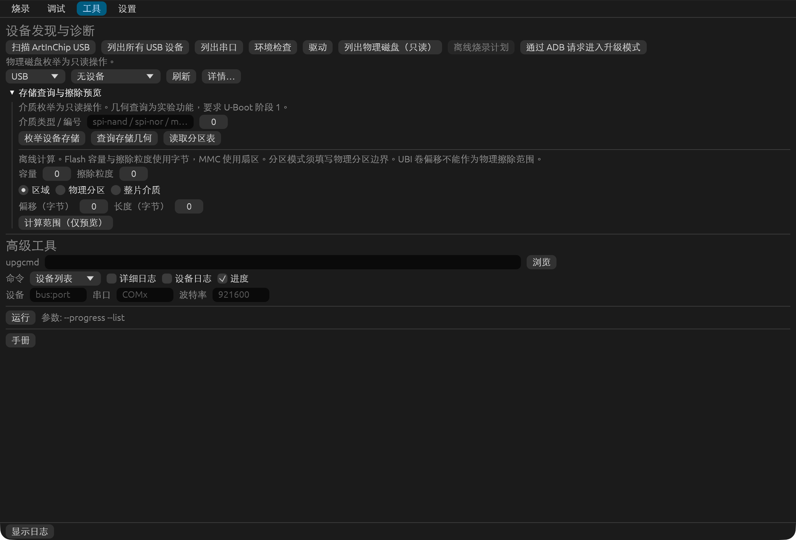

# Command and compatibility reference

[Documentation](README.md) · [简体中文](../zh-CN/reference.md)

## macOS D213 BROM USB

**Known compatibility issue.** Native USB flashing of the ArtInChip D213 in Boot ROM (stage 0, VID:PID `33C3:6677`) is unavailable on the tested Apple Silicon macOS setup. The observations below come from the tested board and USB topology.

- **macOS enumeration.** On macOS 27.0.1, the device appeared as `IOUSBHostDevice` and returned its device descriptor. No active configuration or USB interfaces appeared. On macOS 27.2.1, enumeration encountered Babble (`0xe00002e8`), followed by STRING and CONFIG timeouts (`0xe00002d6`). Configuration 1 and its bulk endpoints (`0x81` IN, `0x02` OUT) remained unavailable. The application can report `LIBUSB_ERROR_OTHER (-99)` for this failure. Reading the first nine bytes of the configuration descriptor still timed out after the host acquired the device through IOUSBHost DeviceCapture.
- **Windows comparison.** The working USB path uses Microsoft's `WinUSB.sys` via the ArtInChip INF. `GET_DESCRIPTOR(STRING1, wLength=2)` produced `USBD_STATUS_BABBLE_DETECTED` (`0xC0000012`). Windows USBXHCI then completed two host-controller commands for EP0, `Reset Endpoint` and `Set TR Dequeue Pointer`. The same WinUSB handle subsequently read the first nine bytes of the configuration descriptor successfully. The exact transaction that triggered Babble on macOS remains unconfirmed.
- **DriverKit investigation.** The unsigned device-level driver built successfully. Xcode rejected provisioning with a Personal Team because the host requires System Extension capability and the driver requires DriverKit and USB Transport capabilities. Activation and device behavior remain unverified. Public USBDriverKit APIs expose no documented way to control initial descriptor ordering or issue the xHCI EP0 recovery commands observed on Windows.

For a board that can enter only BROM, connect its USB cable to a known-working Windows or Linux host. If the board can still boot a U-Boot build with AICUPG UART enabled, macOS can use the project's [UART upgrade path](usage.md#flashing-over-uart) for that bootloader stage.

## CLI and GUI entry points

Use `artinchip-flash <command> --help` for arguments and options. The GUI calls the same Rust services as the CLI. Diagnostic results can be copied or exported as JSON. To export burn events, enable JSON capture in **Advanced options** before burning, then open **Latest structured result** in Tools or Settings.

| CLI | GUI entry |
| --- | --- |
| `scan` | Burn/Debug → USB picker, or Tools → Scan ArtInChip USB |
| `usb-list` | Tools → List all USB devices |
| `serial-list` | Burn/Debug → UART picker, or Tools → List serial ports |
| `burn` | Burn → Start burn, or Tools → Offline burn plan |
| `info` | Burn → Firmware details, or Device details → Device info |
| `uart-monitor` | Burn → UART → UART monitor |
| `env-check` | Tools → Environment check |
| `install-usb-access` | Tools → Driver |
| `write` | Debug → Write memory file |
| `read` | Debug → Save memory |
| `writel` | Debug → Write word |
| `readl` | Debug → Read word |
| `exec` | Debug → Execute address |
| `hexdump` | Debug → View memory |
| `fill` | Debug → Fill bytes |
| `clear` | Debug → Zero memory |
| `memtest` | Debug → Test and restore RAM |
| `shcmd` | Debug → Bootloader shell |
| `log` | Debug → Read device log |
| `stats` | Settings → Statistics |
| `sd-list` | Tools → List physical disks (read-only) |
| `update` | Settings → Check for updates |

## CLI contract

Windows x86-64, Linux x86-64 and macOS arm64 share the commands, option defaults, JSON schemas and exit codes. Platform differences include the native device list, access permissions, path syntax, USB access setup, hardware support and browser launch. Use `serial-list` to find the operating system's port name, such as `COM4`, `/dev/ttyUSB0` or `/dev/cu.usbserial-*`.

| Commands | Output with `--json` | Target selection or platform details |
| --- | --- | --- |
| USB discovery (`scan`, `usb-list`) | One object with `devices` | Empty scans succeed. `scan --require-device` exits `3` when empty. USB status fields can be `null` when unavailable. |
| UART discovery (`serial-list`) | One object with `ports` | Port names use OS conventions. |
| Image and device info (`info`) | One object with `kind: "image"` and `components`, or `kind: "device"` with `transport`, `lines` and optional `storage_media` | An image argument is offline. Device queries use the shared USB/UART options. |
| `env-check` | One object with build fields, configuration and access checks, and `image` | Reports each check separately. A nullable field means the check was unavailable or skipped. An optional image reports its own `ok` and error. |
| `burn --plan` | One plan object with `mode`, `mode_name`, `total_bytes` and `components` | Offline and read-only. |
| `burn` | NDJSON, one event per line | Uses the shared USB/UART options. Ctrl+C requests cancellation at the next safe point. |
| `stats`, `sd-list`, `update` | One object per command. `stats --clear` returns `{"cleared":true}`. | Statistics use the per-user directory; disk identifiers and browser launch are OS-specific. |
| Native debug (`write`, `read`, `writel`, `readl`, `exec`, `hexdump`, `fill`, `clear`, `memtest`, `shcmd`, `log`) | Unsupported | Uses the shared USB/UART options. |
| `uart-monitor`, `install-usb-access` | Unsupported | Monitor auto-selects a unique USB serial port or the only serial port. USB access setup uses WinUSB on Windows and udev on Linux. |

USB commands require a single device by default. To pick a target, use `--device` with a port path or `bus:address` from `scan`, or use `--uart PORT` with the OS port name. These two options are mutually exclusive. Bare `--uart` is equivalent to `--uart auto`. UART baud defaults to 115200; `--speed` can negotiate a higher rate and `--no-enter-upg` disables automatic entry. For safety, full-chip pre-erase always requires an explicit target.

Text diagnostics go to stderr. JSON stdout is reserved for the payload. Operational errors may leave stdout empty, apart from the update error object and a burn's final result once the burn handler has started. Supplying `--json` to an unsupported command is a usage error.

| Exit code | Meaning |
| --- | --- |
| `0` | Success, including an empty scan or a completed upgrade with reset unconfirmed. |
| `1` | General failure such as a local I/O error or update check failure. |
| `2` | Invalid options, image or burn plan. |
| `3` | Missing, ambiguous or inaccessible target. |
| `4` | Transfer or protocol failure, including device CRC mismatch. |
| `10` | An update is available. |
| `130` | Burn cancelled by the user. |

The burn stream retains `stage`, `log`, `component_started`, `component_progress`, `overall_progress`, `component_finished` and `finished`. The terminal `result` carries `status`, `exit_code`, optional `error`, total and non-transfer time (`elapsed_secs`, `non_transfer_secs`), connection and reconnect time (`connection_secs`, `reconnect_secs`), `transfer_secs`, `bytes_sent`, `avg_rate_bps`, `components_completed`, `device_crcs_verified`, `upgrade_ended`, `reset` and `reset_error`. Progress `rate_bps` is computed over consecutive acknowledged payload chunks of the same component and is `null` until that component has two samples. The final average divides acknowledged firmware payload bytes by time spent in write transactions. It excludes USB padding, unselected components, setup, probes and reconnects.

Reset values are `not_attempted`, `skipped`, `acknowledged`, `unconfirmed` and `failed`. An acknowledgement confirms the reset command response. An I/O failure after the reset header can leave the reboot unconfirmed, including when the device drops off USB before its final response. Upgrade completion, device CRC counts and reset status are separate outcomes.

## Storage inspection and erase previews

Tools queries media and partition table text through native UPG. Geometry probing is experimental, requires U-Boot stage 1 and depends on bootloader support. The erase calculator is offline. Enter Flash geometry in bytes or MMC geometry in logical sectors with a confirmed sector size. Offsets and lengths are always in bytes. Partition calculations require physical boundaries. A UBI volume such as `ubiroot:rootfs` identifies an upgrade target and cannot supply raw NAND erase bounds.

## AiBurn compatibility and limits

- Standard USB/UART flashing, image inspection, and memory and bootloader diagnostics run natively. Optional vendor operations, including eFuse and JTAG commands, require a separately installed `upgcmd` configured in Settings. ADB upgrade entry uses the configured executable or the Android Platform Tools on `PATH`.
- Full-chip pre-erase uses `upgcmd flasherase`. It requires every target component, an explicitly pinned device and a matching reported medium. The GUI asks for confirmation with the selected target before erase or force upgrade. Force upgrade is experimental and skips reset.
- The app provides read-only physical disk discovery. SD boot-card writing and native bulk erase or eFuse operations are outside the current implementation. See [hardware validation](development.md#hardware-validation) for the tests still pending.
