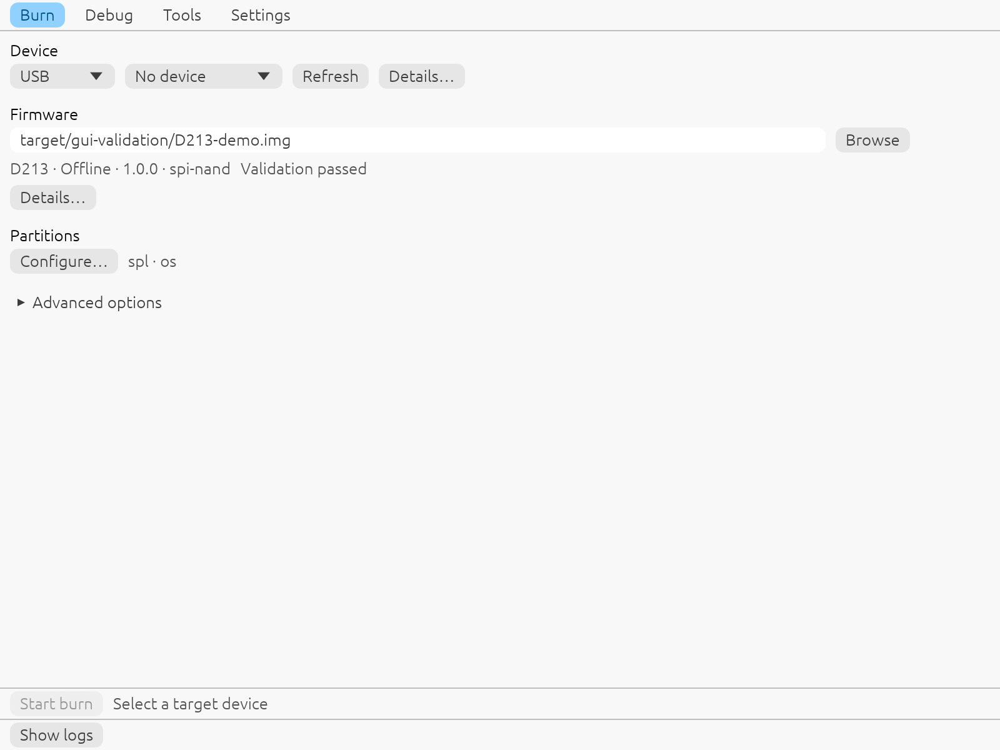

# User guide

[Documentation](README.md) · [简体中文](../zh-CN/usage.md)

## Installation

Download your platform's package from [GitHub Releases](https://github.com/boa-z/artinchip-flash/releases). The Windows setup EXE and MSI, Linux DEB, and macOS arm64 PKG install both the CLI and GUI. Use the Windows ZIP or Linux/macOS tar.gz for portable use. Unsigned Windows and macOS installers may trigger system security prompts.

On Windows, **Tools → Driver** or `artinchip-flash install-usb-access` can install the WinUSB binding for `33c3:6677` with administrator privileges. On Linux, the same command installs the udev rule for non-root access. Reconnect the board after installation. macOS generally requires no kernel driver. If opening the device succeeds but transfers time out, close other USB tools and reconnect. In `scan --json`, `enumerated`, `ioreg_ready` and `protocol_ready` distinguish USB discovery, macOS descriptor readiness and a successful UPG probe.

## Flashing over USB

Enter upgrade mode using the board's documented procedure. For a running system with the ArtInChip console, `aicupg gotobl` requests bootloader upgrade mode. Scanning selects a sole ArtInChip USB device. With multiple boards, select an explicit physical port. The application uses the same port after re-enumeration.

```sh
artinchip-flash scan
artinchip-flash info firmware.img
artinchip-flash burn firmware.img --plan --json
artinchip-flash burn firmware.img --device PORT-PATH
```

### Partition updates

Add `--partition NAME` for each selected target, or pass a comma-separated list. Names can be component aliases such as `os` or exact META partition names such as `ubiroot:rootfs`. The plan verifies image bounds and CRCs before opening a device. The transmitted component list determines which partitions are written. RT-Thread defaults to `spl,env,os`, and name-only Luban Linux images default to all packaged targets.

For a D213 already in U-Boot upgrade mode, query device information and verify stage 1 and `spi-nand`. A zero Chip ID is valid in this case. The following offline command should show mode `0x01` with `image.info` and the selected Rootfs target. To run the checked plan, remove `--plan` and pin the device with `--device PORT-PATH`.

```sh
artinchip-flash burn firmware.img --partition ubiroot:rootfs --no-updater --plan --json
```

## Flashing over UART

The board's bootloader must support UART upgrade (`CONFIG_AICUPG_UART_ENABLE=y`). Use `aicupg uart 0` on the bootloader console if necessary. The app attempts to enter upgrade mode automatically after a failed handshake. Use `--no-enter-upg` to disable this. Close the UART monitor before starting a burn on the same port.

```sh
artinchip-flash serial-list
artinchip-flash burn firmware.img --uart /dev/ttyUSB0
artinchip-flash uart-monitor /dev/ttyUSB0
```

Use `--baud` to set the initial baud rate (115200 by default) and `--speed` to negotiate a higher rate before transfer. macOS serial ports usually use `/dev/cu.*`.

## GUI workflow

1. In **Burn**, choose USB or UART and select the target. Use **Device details** to query device information.
2. Open the firmware image and check its summary. **Firmware details** contains the header, offline validation and extraction. Use **Configure partitions** to check the component selection.
3. Use **Advanced options** for the upgrade mode, boot stage, reset and event logging. For a D213 Rootfs-only upgrade from U-Boot, select **Partition upgrade** and **U-Boot (stage 1): skip RAM updater**.
4. Click **Start burn**. Use **Show logs** for the resizable log pane. **Stop** or CLI `Ctrl+C` requests cancellation at a transfer boundary. The CLI reports cancellation with exit code `130`.



**Debug** provides native memory and bootloader operations. **Tools** provides diagnostics, offline plans, storage inspection and erase previews. See the [command and compatibility reference](reference.md) for entry points and limitations.

## Settings and updates

**Settings** controls language, theme, updates and statistics. `config.ini`, `img_history.txt` and `burn_stats.json` are stored under `%APPDATA%\artinchip-flash` on Windows, `~/Library/Application Support/artinchip-flash` on macOS, or `$XDG_CONFIG_HOME/artinchip-flash` (`~/.config/artinchip-flash` by default) on Linux. An existing `AiBurn.ini` can be imported for compatibility.

`artinchip-flash update` uses the latest stable SemVer release. `--channel nightly` opens access to nightly builds, `--open` opens the download page when an update is available, and `--json` produces machine-readable output. The CLI exits with `10` when a newer version is found. Install updates by replacing the portable package or running the matching installer again. The application does not replace its own binaries.

## Troubleshooting

- For a missing USB device, verify upgrade mode, check USB permissions and try a direct data cable. Run `artinchip-flash env-check` for access and conflicting-service diagnostics.
- For a UART handshake failure, confirm the console port, baud rate and board power. Release the port from other terminal programs before retrying.
- For a failed burn, verify the image matches the board and storage medium. Use `--verbose` for transport details. To collect events, use `burn --log-file FILE`, or enable JSON event capture in the GUI before the burn.
