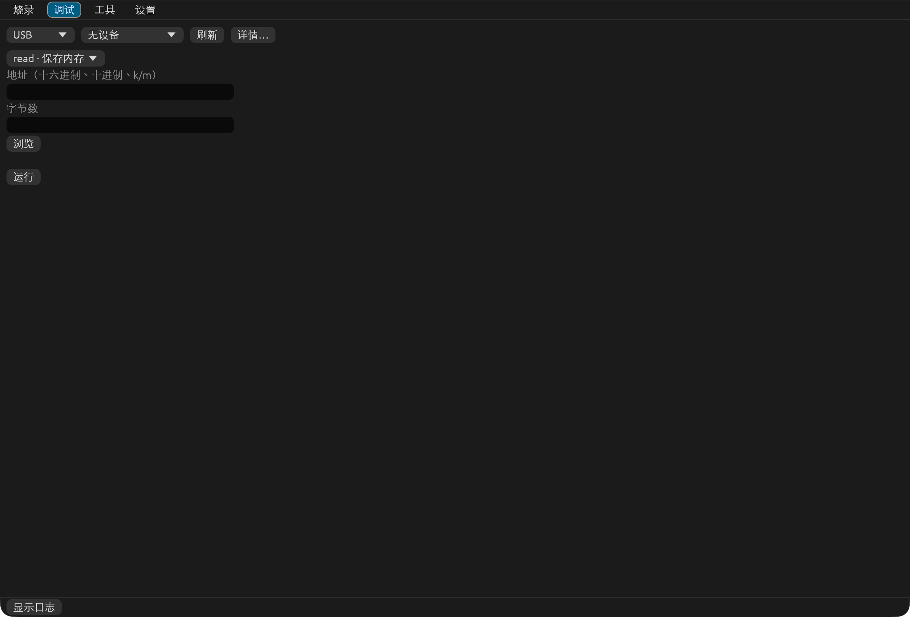
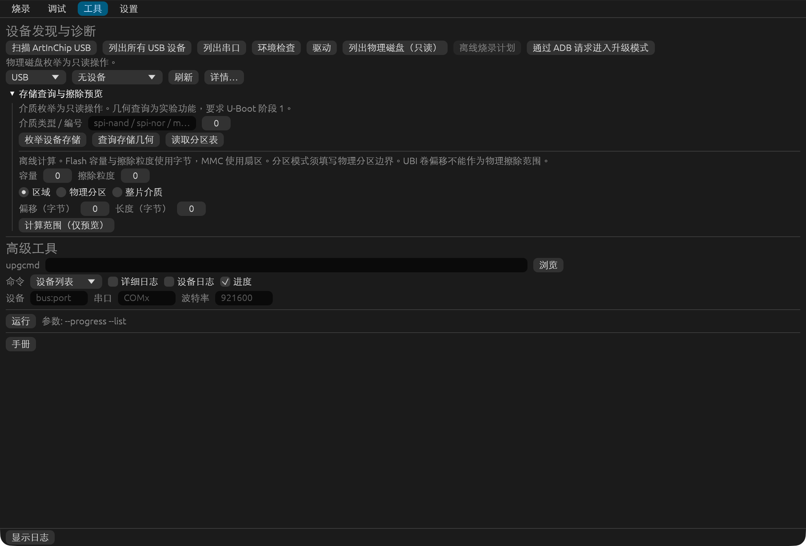

# 命令与兼容性参考

[文档目录](README.md) · [English](../en/reference.md)

## macOS D213 BROM USB

**已知兼容性问题。** 在已测试的 Apple Silicon macOS 环境中，ArtInChip D213 进入 Boot ROM（阶段 0，VID:PID `33C3:6677`）后，当前无法原生 USB 烧录。以下观察来自已测试的开发板和 USB 拓扑。

- **macOS 枚举。** 在 macOS 27.0.1 上，系统可见 `IOUSBHostDevice`，也能读取设备描述符，但没有活动配置或 USB 接口。在 macOS 27.2.1 上，枚举期间出现 Babble（`0xe00002e8`），随后 STRING 和 CONFIG 读取超时（`0xe00002d6`）。Configuration 1 及其 Bulk 端点（IN `0x81`、OUT `0x02`）仍不可用，应用可能显示 `LIBUSB_ERROR_OTHER (-99)`。通过 IOUSBHost DeviceCapture 成功接管设备后，读取配置描述符的前 9 字节仍然超时。
- **Windows 对照。** 已验证可用的 Windows USB 路径通过 ArtInChip INF 绑定微软的 `WinUSB.sys`。`GET_DESCRIPTOR(STRING1, wLength=2)` 触发 `USBD_STATUS_BABBLE_DETECTED`（`0xC0000012`）。随后 Windows USBXHCI 对 EP0 成功执行 `Reset Endpoint` 和 `Set TR Dequeue Pointer` 两条主机控制器命令，同一 WinUSB 句柄紧接着读到配置描述符的前 9 字节。macOS 上触发 Babble 的具体事务仍待确认。
- **DriverKit 调查。** 设备级驱动通过无签名构建。Xcode 确认 Personal Team 无法签发所需 profile，宿主需要 System Extension 能力，驱动需要 DriverKit 和 USB Transport 能力。驱动激活和真机行为仍待验证。公开 USBDriverKit API 没有控制首次描述符读取顺序或发出上述 xHCI EP0 恢复命令的受支持入口。

如果板卡只能进入 BROM，将 USB 接到已验证可用的 Windows 或 Linux 主机。如果板卡仍能运行启用了 AICUPG UART 的 U-Boot，可以在 macOS 上使用该 Bootloader 阶段的[串口升级流程](usage.md#串口烧录)。

## CLI 与 GUI 入口

用 `artinchip-flash <command> --help` 查看参数和选项。GUI 与 CLI 使用同一组 Rust 服务。诊断结果可复制或导出为 JSON。需要导出烧录事件时，在烧录前通过「高级选项」启用 JSON 记录，完成后在「工具」或「设置」中打开「最近一次结构化结果」。

| CLI | GUI 入口 |
| --- | --- |
| `scan` | 烧录或调试 → USB 选择框，或工具 → 扫描 ArtInChip USB |
| `usb-list` | 工具 → 列出所有 USB 设备 |
| `serial-list` | 烧录或调试 → UART 选择框，或工具 → 列出串口 |
| `burn` | 烧录 → 开始烧录，或工具 → 离线烧录计划 |
| `info` | 烧录 → 固件详情，或设备详情 → 设备信息 |
| `uart-monitor` | 烧录 → UART → 串口监视器 |
| `env-check` | 工具 → 环境检查 |
| `install-usb-access` | 工具 → 驱动 |
| `write` | 调试 → 写入文件到内存 |
| `read` | 调试 → 保存内存 |
| `writel` | 调试 → 写入 32 位字 |
| `readl` | 调试 → 读取 32 位字 |
| `exec` | 调试 → 执行指定地址 |
| `hexdump` | 调试 → 查看内存 |
| `fill` | 调试 → 填充字节 |
| `clear` | 调试 → 清零内存 |
| `memtest` | 调试 → 测试并恢复 RAM |
| `shcmd` | 调试 → Bootloader 命令 |
| `log` | 调试 → 读取设备日志 |
| `stats` | 设置 → 烧录统计 |
| `sd-list` | 工具 → 列出物理磁盘（只读） |
| `update` | 设置 → 检查更新 |

## CLI 契约

Windows x86-64、Linux x86-64 和 macOS arm64 共用命令、参数默认值、JSON 结构及退出码。平台差异包括设备列表、访问权限、路径格式、USB 访问配置、硬件支持和浏览器启动。使用 `serial-list` 获取系统串口名，例如 `COM4`、`/dev/ttyUSB0` 或 `/dev/cu.usbserial-*`。

| 命令 | `--json` 输出 | 目标选择或平台说明 |
| --- | --- | --- |
| USB 发现（`scan`、`usb-list`） | 单个包含 `devices` 的对象 | 空扫描成功。`scan --require-device` 在结果为空时返回 `3`。无法获得的 USB 状态字段可以为 `null`。 |
| 串口发现（`serial-list`） | 单个包含 `ports` 的对象 | 端口名称遵循系统约定。 |
| 镜像和设备信息（`info`） | 单个对象，镜像以 `kind: "image"` 和 `components` 标识，设备以 `kind: "device"`、`transport`、`lines` 和可空的 `storage_media` 标识 | 指定镜像时离线查询。设备查询使用通用 USB/UART 选项。 |
| `env-check` | 单个对象，包含构建信息、配置与访问检查、`image` | 分项报告。可空字段表示该项无法检查或已跳过。镜像检查提供 `ok` 和错误详情。 |
| `burn --plan` | 单个对象，包含 `mode`、`mode_name`、`total_bytes` 和 `components` | 离线、只读。 |
| `burn` | NDJSON，每行一个事件 | 使用通用 USB/UART 选项。Ctrl+C 在下一个安全点请求取消。 |
| `stats`、`sd-list`、`update` | 每条命令输出一个对象。`stats --clear` 返回 `{"cleared":true}`。 | 统计使用用户目录。磁盘标识与浏览器启动遵循系统约定。 |
| 原生调试（`write`、`read`、`writel`、`readl`、`exec`、`hexdump`、`fill`、`clear`、`memtest`、`shcmd`、`log`） | 暂不支持 | 使用通用 USB/UART 选项。 |
| `uart-monitor`、`install-usb-access` | 暂不支持 | 监视器自动选择唯一 USB 串口或唯一串口。Windows 配置 WinUSB，Linux 配置 udev。 |

USB 命令默认要求只有一个设备。用 `--device` 指定 `scan` 返回的端口路径或 `bus:address`，或用 `--uart PORT` 指定系统串口名，两者互斥。单独使用 `--uart` 等同于 `--uart auto`。串口默认波特率为 115200，可用 `--speed` 协商更高速率，用 `--no-enter-upg` 禁用自动进入升级模式。整片预擦除必须显式指定目标。

诊断信息写入 stderr，JSON 数据写入 stdout。运行错误可能使 stdout 为空，更新查询的错误对象和进入烧录处理后的最终事件除外。对未支持的命令使用 `--json` 会返回参数错误。

| 退出码 | 含义 |
| --- | --- |
| `0` | 成功，包括空扫描，以及升级完成但复位未确认。 |
| `1` | 一般失败，例如本地 I/O 或更新检查失败。 |
| `2` | 参数、镜像或烧录计划无效。 |
| `3` | 目标缺失、不明确或无法访问。 |
| `4` | 传输或协议失败，包括设备 CRC 不匹配。 |
| `10` | 有可用更新。 |
| `130` | 用户取消烧录。 |

烧录流保留 `stage`、`log`、`component_started`、`component_progress`、`overall_progress`、`component_finished` 和 `finished`。最终 `result` 包含状态 `status`、退出码 `exit_code`、可空的 `error`、总耗时与非传输耗时（`elapsed_secs`、`non_transfer_secs`）、连接与重连耗时（`connection_secs`、`reconnect_secs`）、`transfer_secs`、`bytes_sent`、`avg_rate_bps`、`components_completed`、`device_crcs_verified`、`upgrade_ended`、`reset` 和 `reset_error`。进度的 `rate_bps` 用同一组件连续两次已应答数据块计算，首个样本返回 `null`。最终平均速率按已应答固件有效字节和写入事务耗时计算，排除 USB 填充、未选组件、准备、探测和重连。

复位状态为 `not_attempted`、`skipped`、`acknowledged`、`unconfirmed` 或 `failed`。`acknowledged` 表示设备已应答复位命令。复位命令头发送后若遇到 I/O 错误，重启结果可能未确认，例如设备在最后一次应答前主动断开 USB。升级结束、设备 CRC 验证计数和复位状态分别报告。

## 存储查询与擦除预览

「工具」通过原生 UPG 查询介质和分区表文本。几何查询为实验性功能，需要 U-Boot 阶段 1，且依赖 Bootloader 支持。擦除范围在离线计算器中计算。Flash 几何使用字节，MMC 几何使用逻辑扇区，须核对每扇区字节数。偏移和长度始终使用字节。按分区计算时需要物理边界。`ubiroot:rootfs` 等 UBI 卷是升级目标，其逻辑范围不能用作原始 NAND 擦除范围。

## AiBurn 兼容性与限制

- 常规 USB/UART 烧录、镜像检查、内存和 Bootloader 调试使用原生实现。eFuse 和 JTAG 等可选厂商命令需要单独安装 `upgcmd` 并在设置中配置。ADB 升级入口使用已配置的可执行程序，或 `PATH` 中的 Android Platform Tools。
- 烧录前全片擦除使用 `upgcmd flasherase`，要求选择全部目标组件、明确锁定设备并核对设备报告的介质。擦除或强制升级前，GUI 会显示选中目标并要求确认。强制升级为实验性功能，完成后跳过复位。
- 工具支持只读枚举物理磁盘。当前不支持制作 SD 启动卡、原生 bulk 擦除或原生 eFuse 操作。待验证项目见[硬件验证](development.md#硬件验证)。
