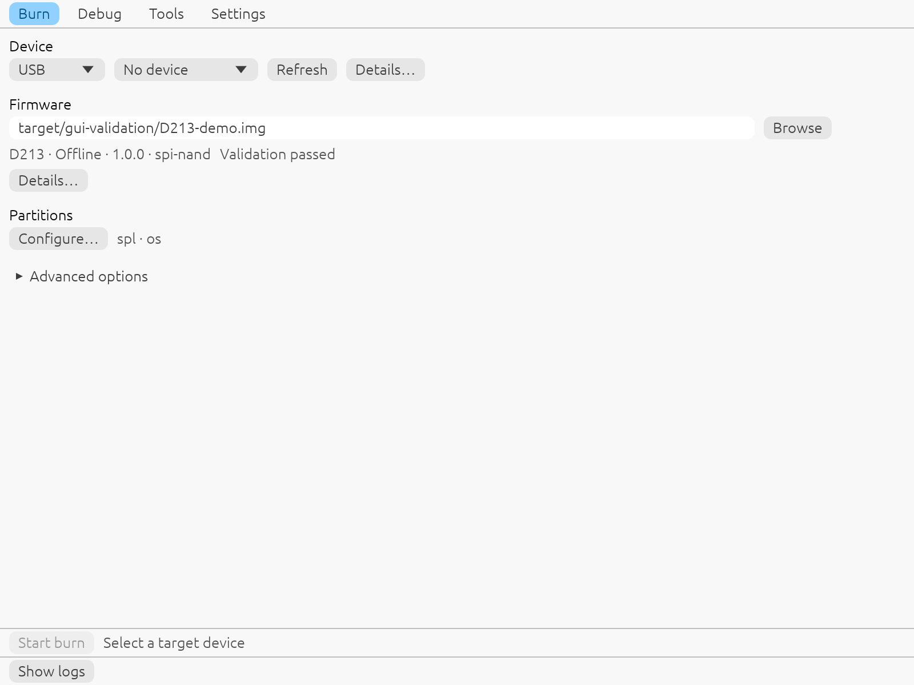

# 使用指南

[文档目录](README.md) · [English](../en/usage.md)

## 安装

在 [GitHub Releases](https://github.com/boa-z/artinchip-flash/releases) 下载对应平台的安装包。Windows 的安装向导 EXE 和 MSI、Linux 的 DEB、macOS arm64 的 PKG 均安装 CLI 和 GUI。便携版可选 Windows ZIP 或 Linux/macOS tar.gz。未签名的 Windows 和 macOS 安装包可能触发系统安全提示。

Windows 下使用「工具 → 驱动」或 `artinchip-flash install-usb-access`，可以管理员权限为 `33c3:6677` 安装 WinUSB 绑定。Linux 下同一命令会安装 udev 规则，允许普通用户访问。安装后重新连接开发板。macOS 通常无需内核驱动。若设备能打开但传输超时，关闭其他 USB 工具后重连。`scan --json` 中的 `enumerated`、`ioreg_ready` 和 `protocol_ready` 分别表示 USB 枚举、macOS 描述符就绪和 UPG 探测成功。

## USB 烧录

> [!IMPORTANT]
> 已测试的 Apple Silicon macOS 环境无法通过 USB 烧录处于 BROM 的 D213（`33C3:6677`）。`scan` 或 USB 注册表中看到设备时，仍可能没有可用的 Bulk 接口。BROM 恢复请使用已验证可用的 Windows 或 Linux 主机。如果板卡仍能进入启用了 AICUPG UART 的 U-Boot，可用[串口烧录](#串口烧录)。参见 [macOS 兼容性研究结果](reference.md#macos-d213-brom-usb)。

按开发板手册进入升级模式。系统已运行且提供 ArtInChip 控制台时，可用 `aicupg gotobl` 请求进入 Bootloader 升级模式。扫描到唯一 ArtInChip USB 设备时会自动选中。有多台设备时，明确选择物理端口。设备重新枚举后会按同一端口重连。

```sh
artinchip-flash scan
artinchip-flash info firmware.img
artinchip-flash burn firmware.img --plan --json
artinchip-flash burn firmware.img --device PORT-PATH
```

### 分区升级

为每个目标添加 `--partition NAME`，也可传入逗号分隔的列表。可用 `os` 等组件别名，或 `ubiroot:rootfs` 等完整 META 分区名。计划会在打开设备前校验镜像边界和 CRC。实际发送的组件列表决定写入哪些分区。RT-Thread 默认选中 `spl,env,os`，仅以名称标识目标的 Luban Linux 镜像默认选中全部打包目标。

若 D213 已进入 U-Boot 升级模式，先读取设备信息，确认 Boot stage 为 1、介质为 `spi-nand`。此场景允许 Chip ID 全零。以下离线命令应显示模式 `0x01`，组件为 `image.info` 和选中的 Rootfs 目标。执行已核对的计划时，移除 `--plan` 并用 `--device PORT-PATH` 锁定设备。

```sh
artinchip-flash burn firmware.img --partition ubiroot:rootfs --no-updater --plan --json
```

## 串口烧录

开发板 Bootloader 必须支持串口升级（`CONFIG_AICUPG_UART_ENABLE=y`）。必要时，在 Bootloader 控制台执行 `aicupg uart 0`。握手失败后工具默认尝试自动进入升级模式，可用 `--no-enter-upg` 关闭。同一端口开始烧录前，请先关闭串口监视器。

```sh
artinchip-flash serial-list
artinchip-flash burn firmware.img --uart /dev/ttyUSB0
artinchip-flash uart-monitor /dev/ttyUSB0
```

用 `--baud` 设置初始波特率（默认 115200），用 `--speed` 在传输前协商更高波特率。macOS 串口通常为 `/dev/cu.*`。

## GUI 操作流程

1. 在「烧录」页选择 USB 或 UART，再选择目标。通过设备「详情」查询设备信息。
2. 打开固件镜像并核对摘要。固件「详情」提供镜像头、离线校验和组件解包。用分区「配置」核对组件选择。
3. 在「高级选项」中设置升级模式、Bootloader 阶段、复位和事件日志。D213 从 U-Boot 单独升级 Rootfs 时，选择「分区升级」和「U-Boot（阶段 1）：跳过 RAM updater」。
4. 点击「开始烧录」。「显示日志」可打开高度可调的日志窗。「停止」或 CLI `Ctrl+C` 会请求在当前数据块边界取消。CLI 以退出码 `130` 表示取消。



「调试」页提供原生内存和 Bootloader 操作。「工具」页提供诊断、离线计划、存储查询和擦除预览。入口和限制见[命令与兼容性参考](reference.md)。

## 设置与更新

在「设置」中管理语言、主题、更新和统计。`config.ini`、`img_history.txt` 和 `burn_stats.json` 保存在用户配置目录。Windows 使用 `%APPDATA%\artinchip-flash`，macOS 使用 `~/Library/Application Support/artinchip-flash`，Linux 使用 `$XDG_CONFIG_HOME/artinchip-flash`（默认 `~/.config/artinchip-flash`）。可导入已有的 `AiBurn.ini`。

`artinchip-flash update` 查询最新的 SemVer 稳定版。可用 `--channel nightly` 查看每日构建通道，`--open` 在有更新时打开下载页，`--json` 输出机器可读结果。有新版时 CLI 退出码为 `10`。更新时替换便携包或重新运行对应安装包。应用不会自动替换自身程序文件。

## 常见问题

- 扫描不到 USB 设备时，确认升级模式和 USB 权限，并尝试更换直连数据线。用 `artinchip-flash env-check` 检查访问权限和冲突服务。
- 串口握手失败时，核对控制台端口、波特率和开发板供电，关闭占用端口的其他终端程序后重试。
- 烧录失败时，核对镜像与板型及介质是否匹配。用 `--verbose` 查看传输细节。可用 `burn --log-file FILE` 收集事件，或在开始烧录前启用 GUI 的 JSON 事件记录。
